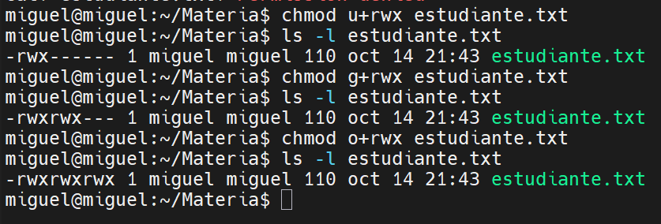
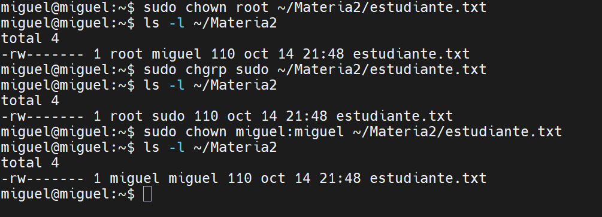
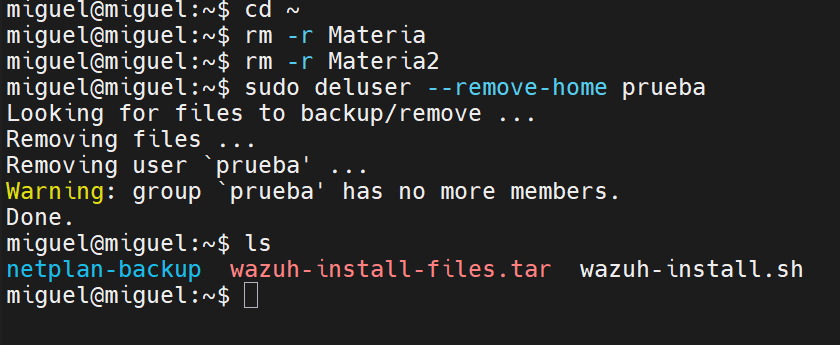

<div align="center">

# 📸 Demostración – Práctica 4
## Gestión de Permisos de Archivos


-E95420?style=for-the-badge&logo=ubuntu&logoColor=white)

</div>

> **Alumno:** Miguel Ramírez Meli · **Matrícula:** 2025-1367 · **ITLA**
> **Materia:** Sistemas Operativos III · **Profesor:** Adrián Alcántara
> **Entorno:** Ubuntu en VMware

Solo se incluyen las capturas más importantes (carpeta `imagen/`).

---

### 1. Crear carpeta y archivo

```bash
mkdir Materia
cd Materia
vi estudiante.txt
ls
cat estudiante.txt
```

**Archivo escrito en el editor `vi`**


**`ls` y `cat` muestran el archivo y su contenido**


---

### 2. Cambiar permisos con chmod 0

```bash
ls -l estudiante.txt
chmod 0 estudiante.txt
ls -l estudiante.txt
cat estudiante.txt
```

**Permisos `----------` y `Permission denied`**


---

### 3. Permisos para usuario, grupo y otros

```bash
chmod u+rwx estudiante.txt
ls -l estudiante.txt
chmod g+rwx estudiante.txt
ls -l estudiante.txt
chmod o+rwx estudiante.txt
ls -l estudiante.txt
```

**Permisos agregados a usuario, grupo y otros**



---

### 4. Quitar permisos y permisos numéricos

```bash
chmod o-rwx estudiante.txt
chmod g-w estudiante.txt
ls -l estudiante.txt
chmod 644 estudiante.txt
chmod 755 estudiante.txt
chmod 600 estudiante.txt
stat -c "%a %A %n" estudiante.txt
```

**Permisos simbólicos y numéricos con `stat`**


---

### 5. Segunda carpeta y exploración de directorios

```bash
cd ~
mkdir Materia2
ls
cd Materia
ls
cd -
cd Materia2
pwd
ls
cd ~
```

**Creación de `Materia2` y navegación**


---

### 6. Permisos en carpetas

```bash
ls -ld Materia Materia2
chmod 000 Materia2
cd Materia2
chmod 755 Materia2
cd Materia2
pwd
cd ~
```

**`cd` denegado con `000` y permitido con `755`**


---

### 7. Copiar archivo a otra carpeta

```bash
cd ~/Materia
cp estudiante.txt ~/Materia2
ls
ls -l ~/Materia2
cd ~
```

**Archivo copiado a `Materia2`**


---

### 8. Cambiar dueño y grupo

```bash
sudo chown root ~/Materia2/estudiante.txt
ls -l ~/Materia2
sudo chgrp sudo ~/Materia2/estudiante.txt
ls -l ~/Materia2
sudo chown miguel:miguel ~/Materia2/estudiante.txt
ls -l ~/Materia2
```

**Cambio de dueño y grupo, y restauración**



---

### 9. Probar permisos con otro usuario

```bash
sudo adduser --disabled-password --gecos "" prueba
chmod o+x ~
chmod 600 ~/Materia/estudiante.txt
sudo -u prueba cat ~/Materia/estudiante.txt
chmod 644 ~/Materia/estudiante.txt
sudo -u prueba cat ~/Materia/estudiante.txt
chmod o-x ~
```

**`prueba` denegado con `600` y permitido con `644`**


---

### 10. Eliminar carpetas y usuario de prueba

```bash
cd ~
rm -r Materia
ls
rm -r Materia2
ls
sudo deluser --remove-home prueba
```

**Carpetas y usuario de prueba eliminados**



---

## Conclusión

Se crearon archivos y carpetas, se modificaron sus permisos de forma simbólica y numérica, se copiaron y se cambió su dueño y grupo. La prueba con un segundo usuario mostró que un archivo con `600` es denegado y con `644` es legible. Al final se eliminaron las carpetas y el usuario de prueba.
