<div align="center">

# 📸 Demostración – Práctica 2
## Configuración de Parámetros de Red


-E95420?style=for-the-badge&logo=ubuntu&logoColor=white)

</div>

> **Alumno:** Miguel Ramírez Meli · **Matrícula:** 2025-1367 · **ITLA**
> **Materia:** Sistemas Operativos III · **Profesor:** Adrián Alcántara
> **Entorno:** Ubuntu en VMware · interfaz real `ens33` · interfaz virtual `CLARO`

Cada paso muestra el comando ejecutado y su captura (carpeta `imagen/`).

---

## Parte 1 - Comandos `ip`, rutas, DNS y DHCP (práctica "prueba")

### 1.1 Crear la interfaz CLARO y mostrar interfaces de red

```bash
sudo modprobe dummy
sudo ip link add CLARO type dummy
sudo ip link set CLARO up
ip a show CLARO
ip link show CLARO
```

**Creación de la interfaz CLARO y verificación con `ip a show` e `ip link show`**


### 1.2 Agregar una IP manualmente

```bash
sudo ip addr add 20.13.67.10/24 dev CLARO
ip a show CLARO
```

**IP 20.13.67.10/24 asignada a CLARO**

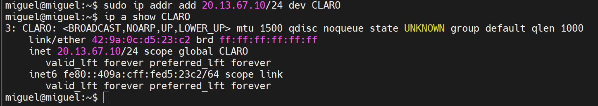

### 1.3 Eliminar y volver a agregar la IP

```bash
sudo ip addr del 20.13.67.10/24 dev CLARO
ip a show CLARO
sudo ip addr add 20.13.67.10/24 dev CLARO
ip a show CLARO
```

**IP eliminada: solo queda la IPv6 link-local**

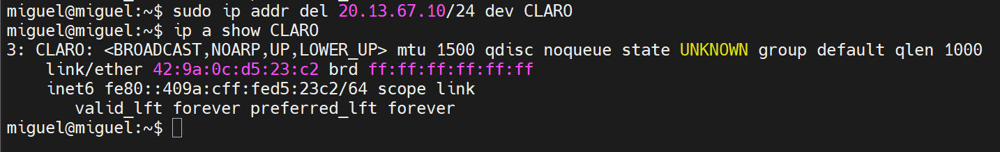

**IP agregada nuevamente**

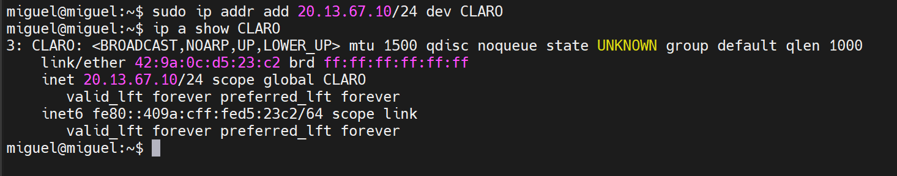

### 1.4 Mostrar rutas

```bash
ip route
```

**Tabla de rutas con la red `20.13.67.0/24` de CLARO**


### 1.5 Agregar gateway

```bash
sudo ip route add default via 20.13.67.1 dev CLARO metric 200
ip route
```

**Dos rutas default: `ens33` (100) y CLARO (200)**


### 1.6 Eliminar el gateway

```bash
sudo ip route del default via 20.13.67.1 dev CLARO
ip route
```

**Ruta default de CLARO eliminada**

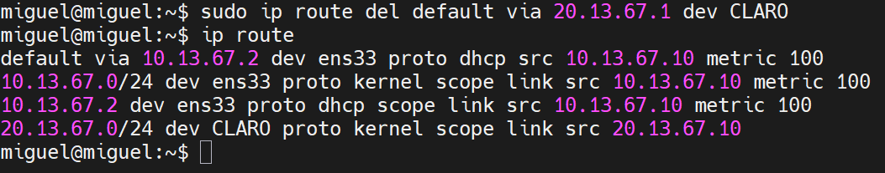

### 1.7 DEFAULT (volver a poner el gateway por defecto)

```bash
sudo ip route add default via 20.13.67.1 dev CLARO metric 200
ip route | grep default
ip route show default
```

**Default agregada y filtrada con `grep`**


**`ip route show default`**


### 1.8 Editar DNS

```bash
cat /etc/resolv.conf
resolvectl status
sudo resolvectl dns ens33 8.8.8.8 1.1.1.1
resolvectl status ens33
cat /etc/resolv.conf
```

**`/etc/resolv.conf` antes del cambio**


**`resolvectl status`: DNS `10.13.67.2` entregado por DHCP**


**DNS cambiado con `resolvectl dns`**


**`/etc/resolv.conf` con `8.8.8.8` y `1.1.1.1`**


**`ping` sin respuesta: ICMP a internet bloqueado por el NAT de la VM (el nombre sí se resolvió)**


### 1.9 Probar el DNS sin depender de ICMP

```bash
resolvectl query google.com
nslookup google.com
ping -c 4 10.13.67.2
```

**`resolvectl query google.com`**


**`nslookup` y ping al gateway `10.13.67.2` con 0% de pérdida**


### 1.10 Renovar DHCP

```bash
ip a show ens33
sudo dhclient -r ens33
ip a show ens33
sudo networkctl renew ens33
ip a show ens33
resolvectl status ens33
ip route show default
```

**`ens33` antes: lease de 1396 s**


**`dhclient -r` sin efecto**


**Lease en 1365 s: solo pasó el tiempo**

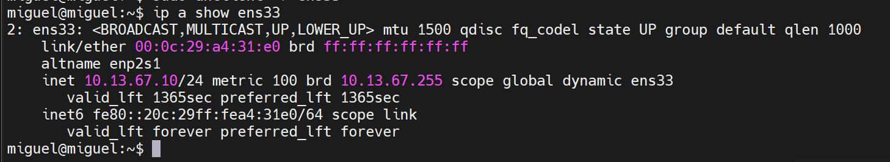

**`networkctl renew ens33`**


**Lease renovado (1769 s), DNS manuales y rutas intactos**

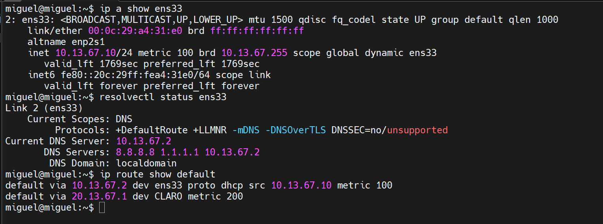

---

## Parte 2 - NMCLI (NetworkManager)

### 2.1 Instalar NetworkManager

```bash
nmcli device status          # nmcli no encontrado
sudo apt update
sudo apt install network-manager -y
nmcli --version
nmcli device status
```

**`nmcli` no está instalado**


**Todas las interfaces `unmanaged`**


### 2.2 Hacer que NetworkManager gestione solo CLARO

```bash
sudo nano /etc/NetworkManager/conf.d/10-manage-claro.conf
# contenido:
# [keyfile]
# unmanaged-devices=*,except:interface-name:CLARO
sudo systemctl restart NetworkManager
nmcli device status
```

**CLARO `connected (externally)`; `ens33` y `lo` siguen `unmanaged`**


### 2.3 Limpiar la configuración manual y crear la conexión

```bash
sudo ip addr flush dev CLARO
sudo ip route del default via 20.13.67.1 dev CLARO
sudo nmcli connection add type dummy ifname CLARO con-name CLARO ipv4.method manual ipv4.addresses 20.13.67.10/24 ipv4.gateway 20.13.67.1
sudo nmcli connection up CLARO
```

**`flush` correcto y `RTNETLINK answers: No such process`**


**Conexión creada (aviso de nombre duplicado)**

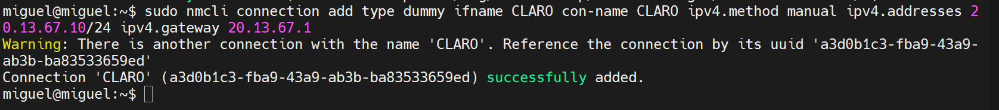

**Conexión activada**

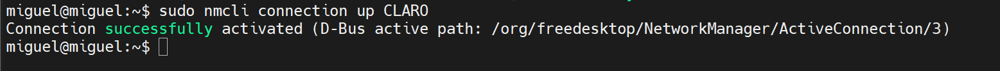

### 2.4 Mostrar conexiones de NetworkManager

```bash
nmcli connection show
nmcli device status
ip a show CLARO
ip route show default
```

**Dos perfiles llamados CLARO**

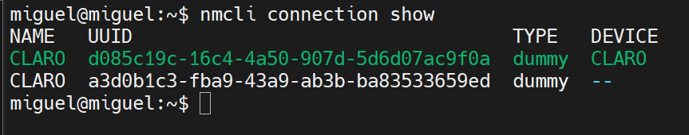

**CLARO `connected` ya sin *externally***


**IP con `noprefixroute` aplicada por NetworkManager**


**Ruta default de CLARO con métrica 550**

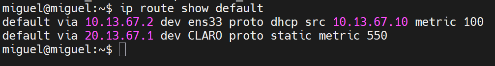

### 2.5 Configuración manual de IP (verificación)

```bash
sudo nmcli connection delete d085c19c-16c4-4a50-907d-5d6d07ac9f0a
sudo nmcli connection up CLARO
nmcli connection show
nmcli connection show CLARO | grep -E "ipv4.method|ipv4.addresses|ipv4.gateway|ipv4.dns"
```

**Perfil único con IP manual**

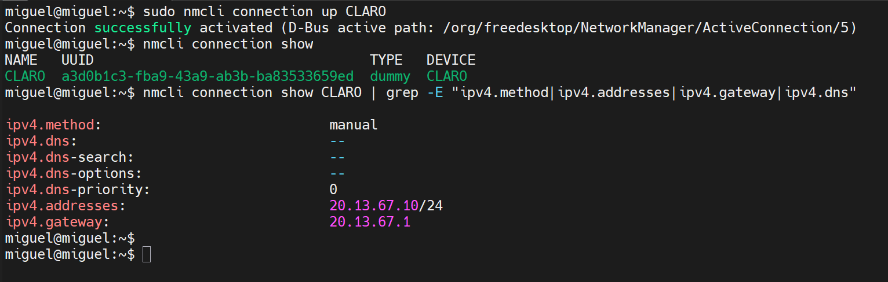

### 2.6 DNS manual con 8.8.8.8 y 1.1.1.1

```bash
sudo nmcli connection modify CLARO ipv4.dns "8.8.8.8 1.1.1.1"
nmcli connection show CLARO | grep ipv4.dns
```

**`ipv4.dns: 8.8.8.8,1.1.1.1`**


### 2.7 DHCP: permitir DNS manual (ignorar los del DHCP)

```bash
sudo nmcli connection modify CLARO ipv4.method auto ipv4.ignore-auto-dns yes
nmcli connection show CLARO | grep -E "ipv4.method|ignore-auto-dns|ipv4.dns:"
```

**`method auto` con `ignore-auto-dns yes`**


### 2.8 DHCP + DNS manuales juntos

```bash
sudo nmcli connection modify CLARO ipv4.ignore-auto-dns no
nmcli connection show CLARO | grep -E "ipv4.method|ignore-auto-dns|ipv4.dns:"
```

**`method auto` con `ignore-auto-dns no`**


### 2.9 Volver a manual y reiniciar la conexión

```bash
sudo nmcli connection modify CLARO ipv4.method manual ipv4.addresses 20.13.67.10/24 ipv4.gateway 20.13.67.1
sudo nmcli connection down CLARO && sudo nmcli connection up CLARO
nmcli device status
ip a show CLARO
ip route show default
```

**Perfil de nuevo en `manual`**


**`down` y `up` correctos; CLARO conserva la IP**


**Ruta default de CLARO reaplicada (métrica 550)**

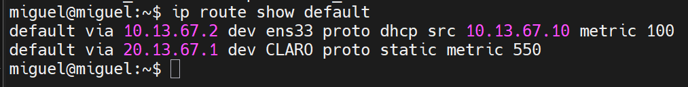

### 2.10 Probar conectividad

```bash
resolvectl status CLARO
nslookup google.com
ping -c 4 20.13.67.10
ping -c 4 10.13.67.2
```

**DNS `8.8.8.8 1.1.1.1` en el link CLARO**


**`nslookup google.com`**


**Ping a `20.13.67.10`, 0% pérdida**


**Ping a `10.13.67.2`, 0% pérdida**


---

## Parte 3 - DHCP y Netplan

### 3.1 Eliminar todas las direcciones IP estáticas

```bash
ip a show CLARO
sudo ip addr flush dev CLARO
ip a show CLARO
```

**CLARO con IP antes del `flush`**


**`ip addr flush dev CLARO`**


**CLARO sin IPv4**

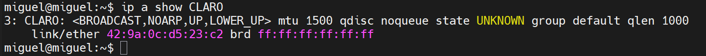

### 3.2 Configuración automática DHCP

```bash
sudo nmcli connection modify CLARO ipv4.addresses "" ipv4.gateway ""
# Error: ipv4.addresses: this property cannot be empty for 'method=manual'
sudo nmcli connection modify CLARO ipv4.method auto ipv4.addresses "" ipv4.gateway ""
nmcli connection show CLARO | grep -E "ipv4.method|ipv4.addresses|ipv4.gateway"
```

**`method auto`, sin direcciones ni gateway**


### 3.3 Reiniciar

```bash
sudo nmcli connection down CLARO && sudo nmcli connection up CLARO
nmcli device status
ip a show CLARO
ip route show default
```

**Timeout de DHCP al activar**

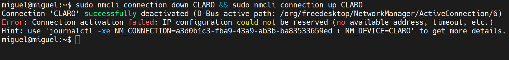

**CLARO `disconnected`**


**CLARO sin IP**

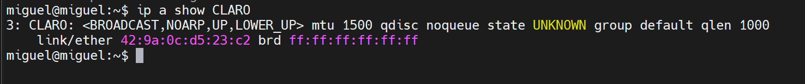

**Solo queda la default de `ens33`**


### 3.4 Netplan: respaldo y archivo actual

```bash
mkdir -p ~/netplan-backup
sudo cp /etc/netplan/*.yaml ~/netplan-backup/
ls ~/netplan-backup
cd /etc/netplan
ls
sudo cat 50-cloud-init.yaml
```

**Respaldo creado**

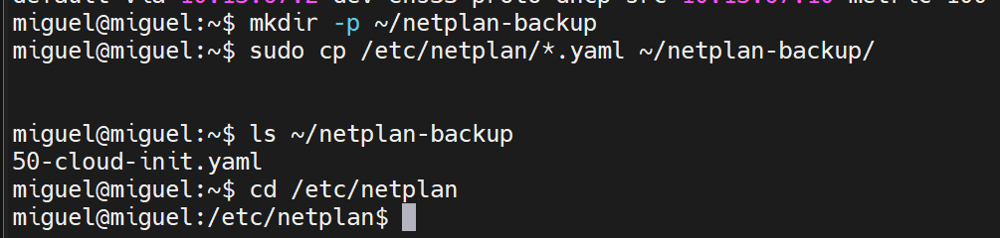

**`ls` en `/etc/netplan`**


**Contenido de `50-cloud-init.yaml`**


### 3.5 Netplan: crear el YAML

```bash
sudo nano 01-network-manager-all.yaml
sudo chmod 600 01-network-manager-all.yaml
ls -l
sudo cat 01-network-manager-all.yaml
```

**YAML en `nano`**


**Permisos `600`**


**`cat` del YAML**


### 3.6 Netplan: validar y aplicar

```bash
sudo netplan generate
sudo netplan try
```

**`netplan generate` y `netplan try`: *Configuration accepted***


### 3.7 Netplan: verificar

```bash
ip a show CLARO
ip route show default
resolvectl status CLARO
networkctl status CLARO
nmcli device status
```

**IP, rutas y DNS aplicados por netplan**

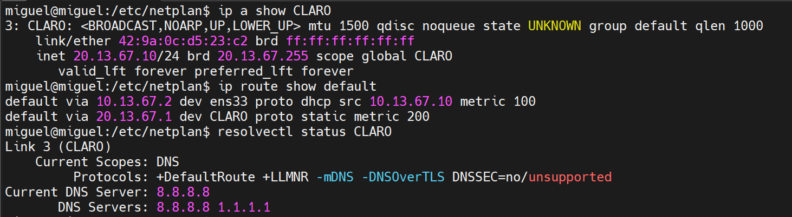

**`networkctl status CLARO` con `10-netplan-CLARO.network`**


**Log de reconfiguración y `nmcli device status`**


---

## Conclusión

Se configuraron parámetros de red en Linux de tres formas: con el comando `ip` (IP, rutas, gateway), con `resolvectl`/`networkctl` (DNS y DHCP) y con `nmcli` y Netplan de forma persistente. Todo se verificó con `ip`, `resolvectl`, `networkctl`, `nslookup` y `ping`, sin perder la conectividad de la interfaz real `ens33`.
