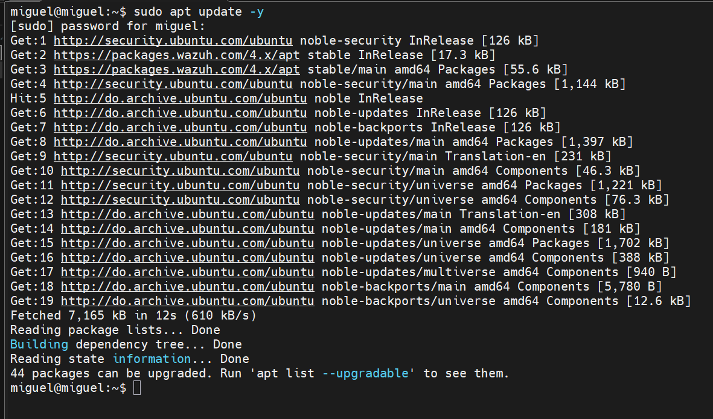
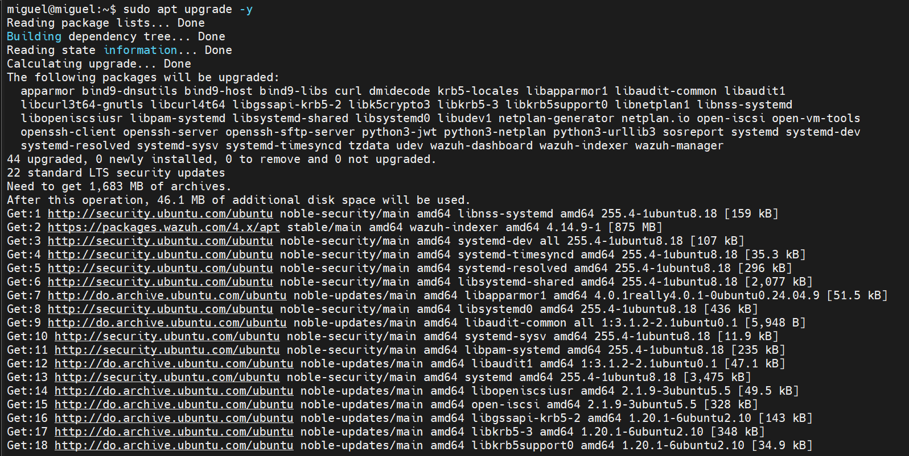
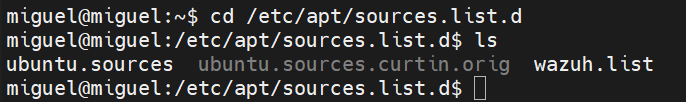
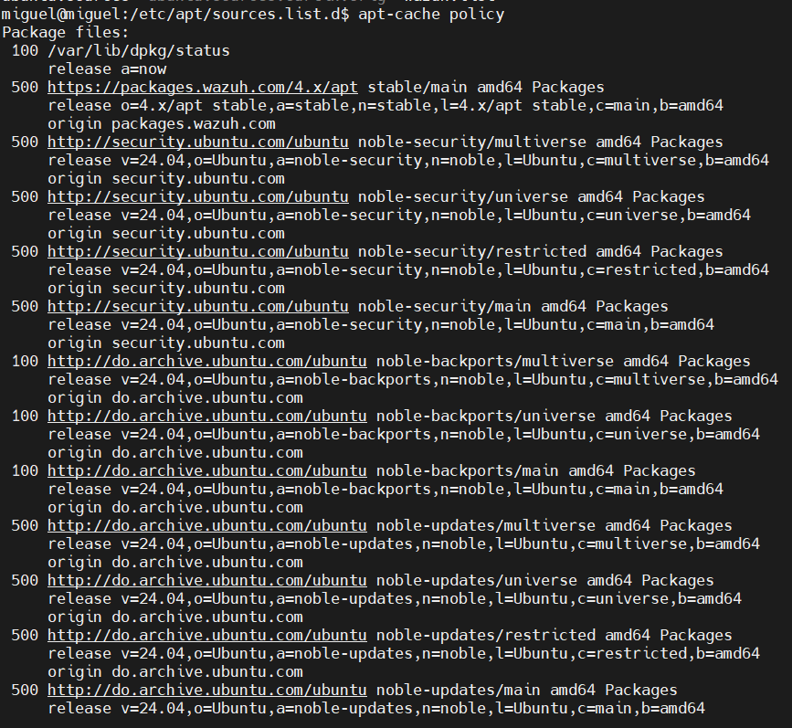
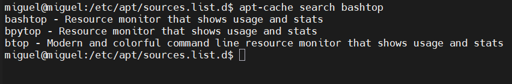
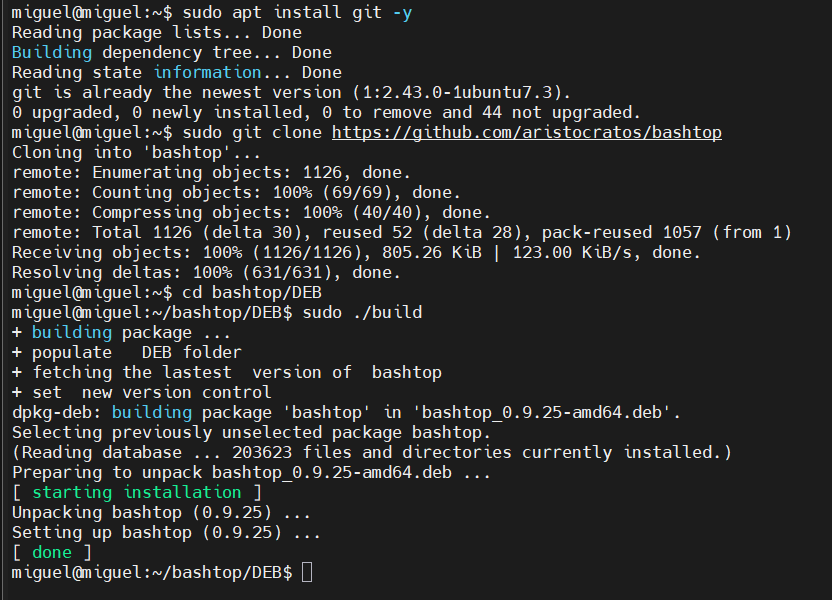
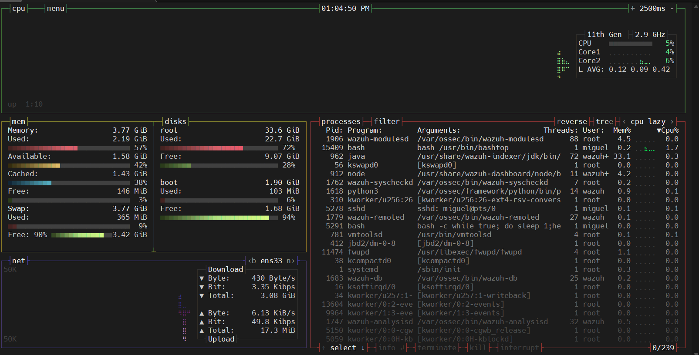
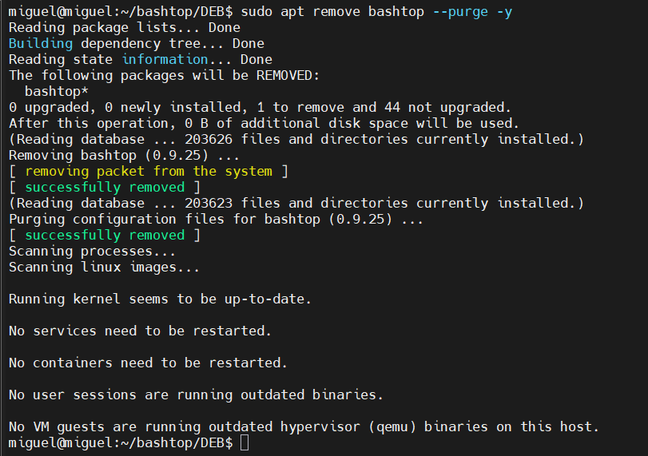
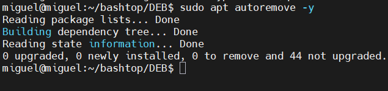
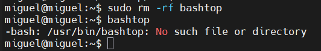

# Practica 1: Gestion de repositorios e instalacion de Bashtop

## Guia y demostracion

```bash
Estudiante : Miguel Ramirez (Meli)
Matricula  : 20251367
Materia    : Sistemas Operativos III
Maestro    : Adrian Alcantara
```

| Campo | Detalle |
|---|---|
| **Sistema** | Ubuntu 24.04 LTS (noble), arquitectura amd64 |
| **Usuario / equipo** | `miguel@miguel` |

---

## Indice

1. [Objetivo](#1-objetivo)
2. [Resumen de lo realizado](#2-resumen-de-lo-realizado)
3. [Requisitos previos](#3-requisitos-previos)
4. [Desarrollo y demostracion paso a paso](#4-desarrollo-y-demostracion-paso-a-paso)
5. [Script completo](#5-script-completo)
6. [Observaciones y detalles importantes](#6-observaciones-y-detalles-importantes)
7. [Conclusiones](#7-conclusiones)

---

## 1. Objetivo

Aprender a administrar los repositorios y paquetes de un sistema Ubuntu desde la terminal, y comprobar el ciclo de vida completo de un programa: buscarlo, instalarlo desde el codigo fuente (GitHub), ejecutarlo y desinstalarlo por completo, dejando el sistema limpio.

El programa usado como ejemplo es **Bashtop**, un monitor de recursos en terminal que muestra el uso de CPU, memoria, discos, red y procesos.

---

## 2. Resumen de lo realizado

| Paso | Accion | Resultado |
|---|---|---|
| 1 | Actualizar repositorios y paquetes | 44 paquetes actualizados |
| 2 | Listar repositorios usados | `ubuntu.sources`, `ubuntu.sources.curtin.orig`, `wazuh.list` |
| 3 | Buscar bashtop en los repositorios | Aparecen `bashtop`, `bpytop` y `btop` |
| 4 | Instalar Git | Ya estaba en su version mas reciente |
| 5 | Clonar Bashtop desde GitHub | 1126 objetos descargados |
| 6 | Compilar e instalar | Paquete `bashtop_0.9.25-amd64.deb` instalado |
| 7 | Ejecutar Bashtop | Interfaz funcionando correctamente |
| 8 | Desinstalar con configuraciones | `bashtop` eliminado con `--purge` |
| 9 | Eliminar dependencias innecesarias | No habia nada que eliminar |
| 10 | Borrar la carpeta descargada | Carpeta eliminada y comando verificado como inexistente |

---

## 3. Requisitos previos

- Ubuntu 24.04 con acceso a internet.
- Un usuario con permisos de `sudo`.
- Una terminal abierta (por ejemplo, por SSH o desde el escritorio).

---

## 4. Desarrollo y demostracion paso a paso

### Paso 1. Actualizar repositorios y paquetes

Antes de instalar cualquier cosa conviene refrescar la lista de paquetes disponibles y actualizar los que ya estan instalados.

```bash
sudo apt update -y
sudo apt upgrade -y
```

- `apt update` descarga la informacion mas reciente de los repositorios configurados. No instala nada.
- `apt upgrade` instala las versiones nuevas de los paquetes que ya existen en el sistema.
- `-y` responde "si" automaticamente a las confirmaciones.

**Resultado:**

- `apt update` descargo 7,165 kB en 12 segundos y reporto que **44 paquetes** se podian actualizar.
- `apt upgrade` actualizo esos **44 paquetes** (0 nuevos, 0 a eliminar, 0 sin actualizar), entre ellos `systemd`, `openssh-server`, `curl`, `apparmor` y los paquetes de Wazuh (`wazuh-indexer`, `wazuh-manager`, `wazuh-dashboard`). Se indico que eran 22 actualizaciones de seguridad LTS y que se necesitaba descargar 1,683 MB.





---

### Paso 2. Listar los repositorios usados

Se revisa la carpeta donde Ubuntu guarda los repositorios adicionales y despues la politica de paquetes, que indica de donde se descarga cada cosa y con que prioridad.

```bash
cd /etc/apt/sources.list.d/
ls
apt-cache policy
```

**Resultado:**

- En `/etc/apt/sources.list.d/` hay tres archivos: `ubuntu.sources`, `ubuntu.sources.curtin.orig` y `wazuh.list`.
- `apt-cache policy` muestra los origenes activos: el repositorio de Wazuh (`packages.wazuh.com/4.x/apt`) y los repositorios oficiales de Ubuntu para `noble-security`, `noble-updates` y `noble-backports`, en sus componentes `main`, `universe`, `restricted` y `multiverse`. Los repositorios de seguridad y actualizaciones tienen prioridad 500 y los de backports prioridad 100.





---

### Paso 3. Buscar bashtop en los repositorios

```bash
apt-cache search bashtop
```

**Resultado:** la busqueda devolvio tres programas parecidos:

| Paquete | Descripcion |
|---|---|
| `bashtop` | Monitor de recursos que muestra uso y estadisticas |
| `bpytop` | Monitor de recursos que muestra uso y estadisticas |
| `btop` | Monitor de recursos moderno y colorido en linea de comandos |

Esto confirma que `bashtop` existe como paquete, aunque en esta practica se instala desde GitHub para ver el proceso de compilacion manual.



---

### Paso 4. Instalar Git

Git es necesario para clonar el repositorio de Bashtop.

```bash
sudo apt install git -y
```

**Resultado:** el sistema informo que Git ya estaba en la version mas reciente (`1:2.43.0-1ubuntu7.3`), por lo que no se instalo nada nuevo (0 upgraded, 0 newly installed).

---

### Paso 5. Descargar Bashtop desde GitHub

```bash
sudo git clone https://github.com/aristocratos/bashtop
```

**Resultado:** se creo la carpeta `bashtop` y se descargaron 1126 objetos (805.26 KiB) y se resolvieron 631 deltas, todo al 100%.

---

### Paso 6. Compilar e instalar Bashtop

```bash
cd bashtop/DEB
sudo ./build
```

El script `build` genera un paquete `.deb` y lo instala automaticamente.

**Resultado:**

- Se construyo el paquete `bashtop_0.9.25-amd64.deb`.
- Se desempaqueto y configuro `bashtop (0.9.25)`.
- Termino con el mensaje `[ done ]` y sin errores.

Captura de los pasos 4, 5 y 6:



---

### Paso 7. Ejecutar Bashtop

```bash
bashtop
```

**Resultado:** Bashtop abrio correctamente y mostro:

- **CPU:** procesador de 11a generacion a 2.9 GHz, uso por nucleo y promedio de carga (L AVG: 0.12 0.09 0.42).
- **Memoria:** 3.77 GiB totales, 2.19 GiB usados y 3.77 GiB de swap.
- **Discos:** particion raiz con 33.6 GiB y 72% usado; particion boot con 1.90 GiB.
- **Red:** interfaz `ens33` con velocidades de subida y bajada.
- **Procesos:** lista con 239 procesos, entre ellos los servicios de Wazuh y `sshd`.



---

### Paso 8. Desinstalar Bashtop junto con sus configuraciones

```bash
sudo apt remove bashtop --purge -y
```

- `remove` quita el programa.
- `--purge` ademas borra sus archivos de configuracion.

**Resultado:** se elimino `bashtop (0.9.25)` y luego se purgaron sus archivos de configuracion. Ambas etapas terminaron con `[ successfully removed ]`. El conteo de archivos instalados paso de 203,626 a 203,623.



---

### Paso 9. Eliminar dependencias ya no necesarias

```bash
sudo apt autoremove -y
```

**Resultado:** `0 upgraded, 0 newly installed, 0 to remove and 44 not upgraded`. No quedaban dependencias huerfanas, ya que Bashtop no instalo paquetes adicionales.



---

### Paso 10. Borrar la carpeta descargada y verificar

```bash
sudo rm -rf bashtop
bashtop
```

**Resultado:** se elimino la carpeta clonada. Al ejecutar `bashtop` de nuevo, el sistema respondio `-bash: /usr/bin/bashtop: No such file or directory`, lo que confirma que el programa quedo completamente desinstalado.



---

## 5. Script completo

Estos son los comandos que funcionaron, en el orden en que se ejecutaron:

```bash
# 1. Actualizar repositorios y paquetes
sudo apt update -y
sudo apt upgrade -y

# 2. Listar repositorios usados
cd /etc/apt/sources.list.d/
ls
apt-cache policy

# 3. Buscar bashtop en los repositorios
apt-cache search bashtop

# 4. Instalar Git
sudo apt install git -y

# 5. Descargar Bashtop desde GitHub (desde la carpeta personal)
cd ~
sudo git clone https://github.com/aristocratos/bashtop

# 6. Compilar e instalar
cd bashtop/DEB
sudo ./build

# 7. Ejecutar
bashtop

# 8. Desinstalar con configuraciones
sudo apt remove bashtop --purge -y

# 9. Eliminar dependencias innecesarias
sudo apt autoremove -y

# 10. Borrar la carpeta descargada y verificar
cd ~
sudo rm -rf bashtop
bashtop
```

---

## 6. Observaciones y detalles importantes

- **Carpeta de descarga:** el guion original indicaba clonar en `~/Desktop`, pero en la practica el clonado se hizo desde la carpeta personal (`~`), por lo que Bashtop quedo en `~/bashtop`. Lo mismo aplica al borrado final.
- **Uso de `sudo` con `git clone`:** la carpeta clonada queda con el usuario `root` como propietario. Funciona, pero lo mas limpio es clonar sin `sudo` y usar `sudo` solo en el `./build`.
- **Repositorio de Wazuh:** el equipo tiene el repositorio de Wazuh configurado, por eso aparece en `apt update` y se actualizaron sus paquetes durante el `upgrade`.
- **Bashtop en los repositorios:** `apt-cache search` mostro que existe un paquete `bashtop`, asi que tambien se podria instalar con `sudo apt install bashtop`. Se uso GitHub para practicar la instalacion desde el codigo fuente.
- **Alternativas modernas:** `bpytop` y `btop` son sucesores de Bashtop y tambien aparecieron en la busqueda.
- **Salir de Bashtop:** dentro del programa se sale con la tecla `q`.

---

## 7. Conclusiones

Se completo el ciclo completo de gestion de un programa en Ubuntu: actualizacion del sistema, revision de repositorios, busqueda de paquetes, instalacion desde GitHub, ejecucion, desinstalacion con `--purge`, limpieza de dependencias y borrado de los archivos descargados. La verificacion final (`No such file or directory`) demuestra que el sistema quedo sin rastros de Bashtop.

---

```bash
Estudiante : Miguel Ramirez (Meli)
Matricula  : 20251367
Materia    : Sistemas Operativos III
Maestro    : Adrian Alcantara
```
