<h1 align="center">Práctica 3 – Disco adicional, partición y sistema de archivos EXT4</h1>

  
  
  
  
  

  
  
  
  

---

## 📌 Descripción

Evidencias de la práctica realizada en Ubuntu Server (VMware) en el ITLA: se adjuntó un disco virtual de 20 GB, se creó una partición, se formateó en **EXT4**, se montó en una carpeta, se guardó un archivo y se comprobó que el archivo permanece en el disco al montarlo en otro punto. Los comandos usados están en [GUIA.md](GUIA.md).

---

## 📸 Evidencias

### 1. Disco de 20 GB adjuntado en VMware
En la configuración de la VM aparece **Hard Disk 2 (SCSI) de 20 GB** junto al disco del sistema de 40 GB. Se agregó con la VM apagada.

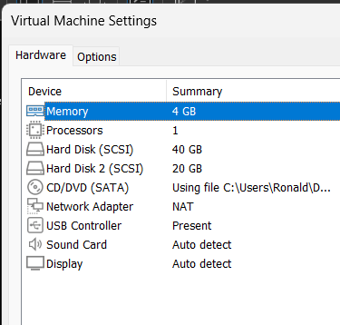

### 2. Disco nuevo detectado con `lsblk`
Después de reiniciar la VM, `lsblk` muestra `sdb` de 20G sin particiones, junto al disco del sistema `sda` de 40G.

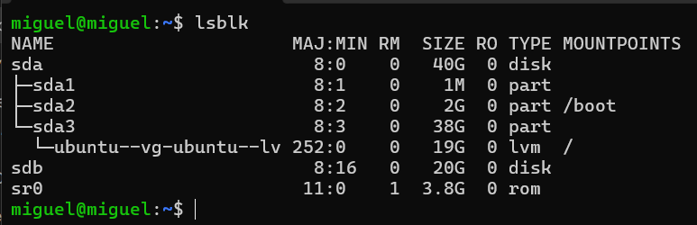

### 3. Detalle del disco con `fdisk -l`
`sudo fdisk -l` confirma `Disk /dev/sdb: 20 GiB`. Es el disco que se va a particionar; `sda` es el del sistema y no se toca.

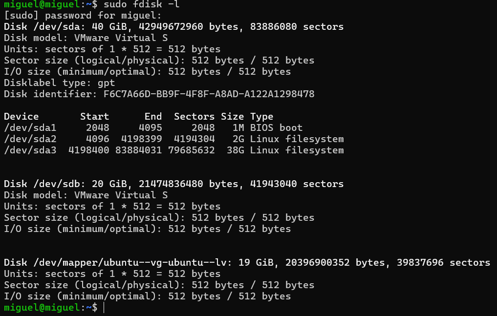

### 4. Creación de la partición con `fdisk`
Dentro de `fdisk /dev/sdb` se usó `n` (nueva), `p` (primaria), partición `1` y los valores por defecto de inicio y fin. El resultado es una partición de 20 GiB, que se guarda con `w`.

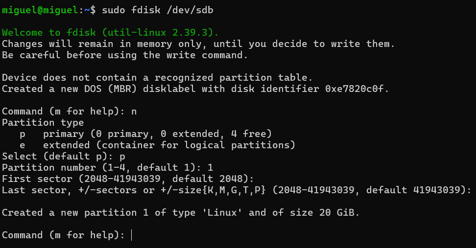

### 5. Partición `sdb1` creada
`lsblk` muestra ahora `sdb1` de 20G dentro de `sdb`, lo que confirma que la partición se guardó correctamente.

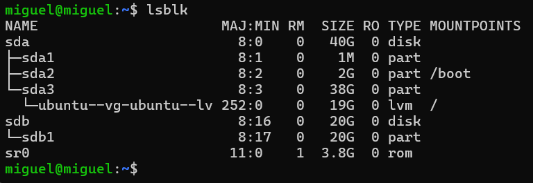

### 6. Formato de la partición en EXT4
`sudo mkfs.ext4 /dev/sdb1` crea el sistema de archivos y termina con `Writing superblocks and filesystem accounting information: done`.

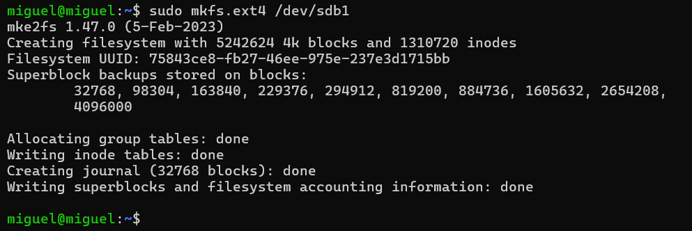

### 7. Verificación del sistema de archivos
`lsblk -f` muestra `sdb1` con el tipo `ext4` y su UUID, confirmando que el formato se aplicó.

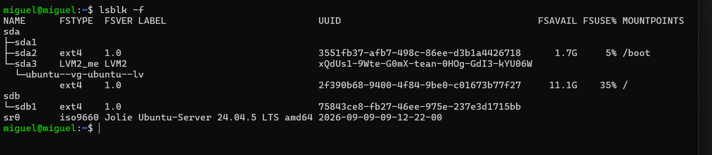

### 8. Montaje del disco en la carpeta SO3
Se creó `~/Desktop/SO3` y se montó `/dev/sdb1` ahí. `df -h` muestra el disco de 20G montado en `/home/miguel/Desktop/SO3`.

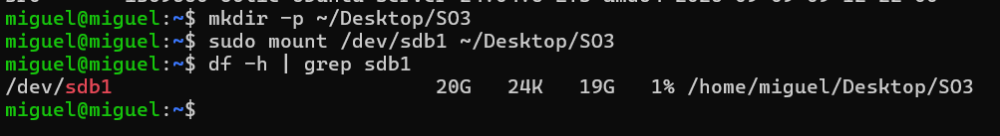

### 9. Archivo creado dentro del disco
Dentro de `SO3` se creó `AdrianAlcantara.txt`. El listado también muestra `lost+found`, una carpeta que EXT4 crea automáticamente.

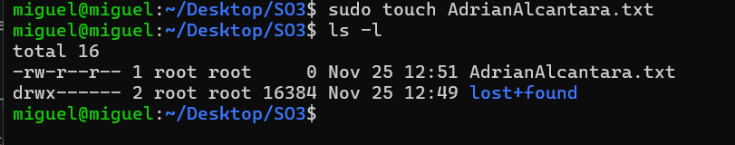

### 10. Disco desmontado
Tras salir de la carpeta con `cd ~`, `umount` desmonta el disco sin errores y la carpeta `SO3` queda vacía, porque el contenido vive en el disco y no en la carpeta.

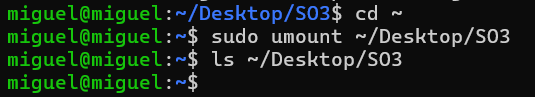

### 11. Montaje en `/mnt` y comprobación del archivo
Se montó `/dev/sdb1` en `/mnt` y `ls /mnt` muestra `AdrianAlcantara.txt`, lo que demuestra que el archivo se conservó en el disco.

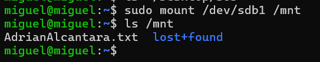

---

## 👤 Autor

**Miguel Ramírez (Meli)** · Matrícula 20251367
Institución: ITLA
Materia: Sistemas Operativos 3
Profesor: Adrián Alcántara
