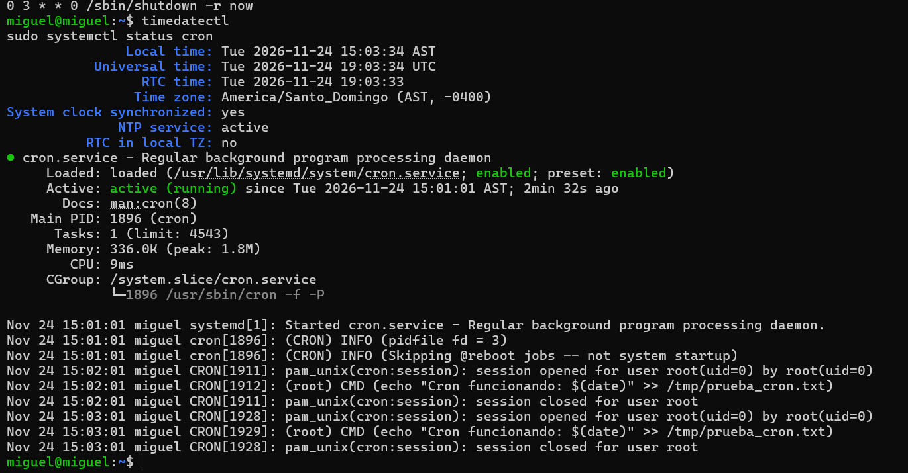
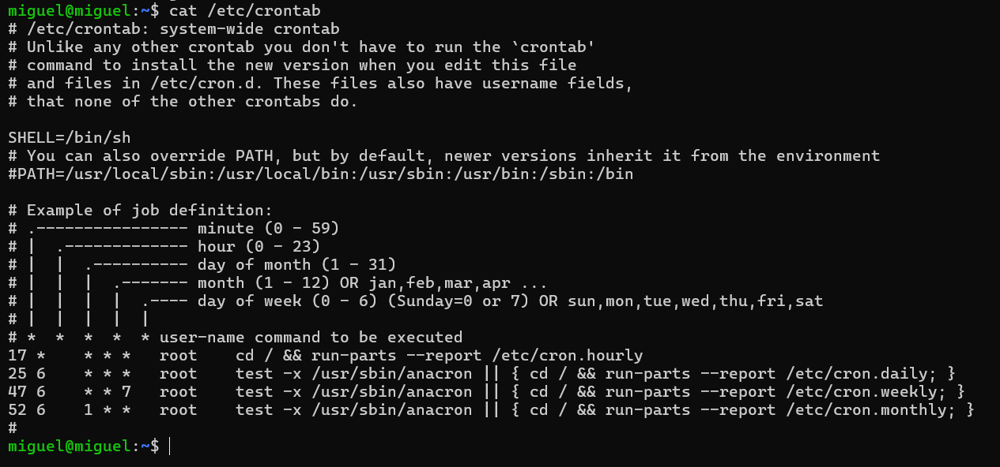
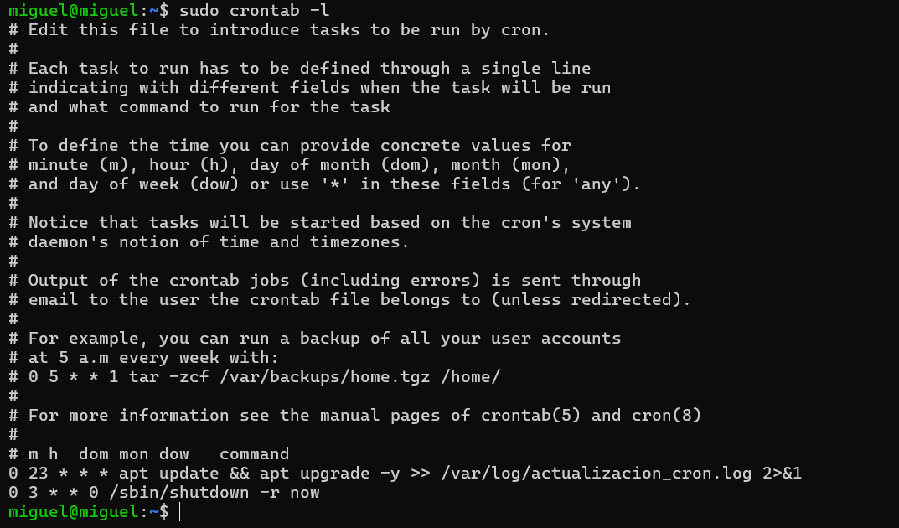
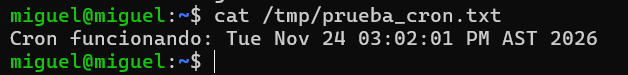
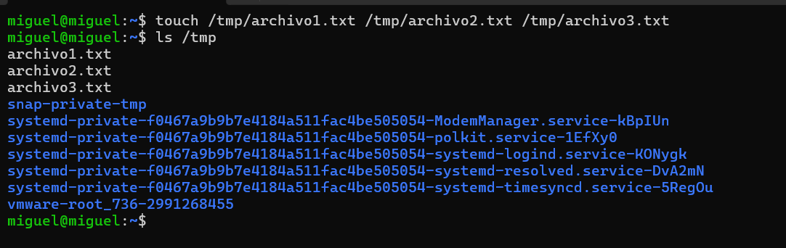
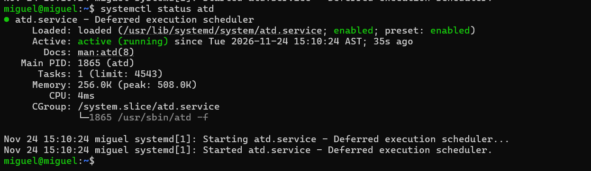
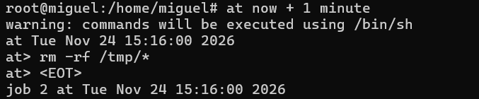
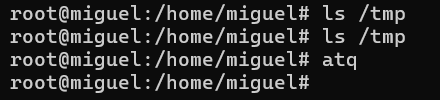
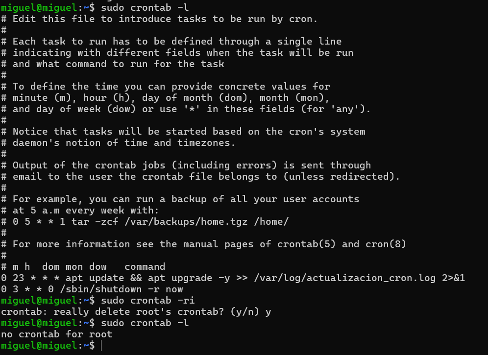

<h1 align="center">Práctica 2 – Cron, reinicio automático y tarea AT</h1>

  
  
  
  
  

  
  
  

---

## 📌 Descripción

Evidencias de la práctica realizada en Ubuntu Server (VMware) en el ITLA: se programaron tareas con **cron** (actualización diaria a las 11 PM y reinicio los domingos a las 3 AM) y una tarea única con **at** que borra el contenido de `/tmp`. Los comandos usados están en [GUIA.md](GUIA.md).

---

## 📸 Evidencias

### 1. Cron activo y zona horaria
Se verifica que el servicio `cron` está en `active (running)` y que la zona horaria es `America/Santo_Domingo`, necesaria para que "las 11 PM" sean la hora local. Los registros inferiores muestran a cron ejecutando una tarea.

### 2. Archivo `/etc/crontab`
Contenido del crontab del sistema con el formato de cada tarea: minuto, hora, día del mes, mes y día de la semana. Sirve de referencia para escribir las tareas propias.

### 3. Tareas programadas en el crontab de root
Las dos tareas de la práctica: actualización del sistema todos los días a las 11 PM (`0 23 * * *`) y reinicio los domingos a las 3 AM (`0 3 * * 0`). Se guardaron en el crontab de root para que tengan permisos.

### 4. Prueba de ejecución de cron
Se programó una tarea temporal que escribe la fecha en un archivo cada minuto. El archivo con el mensaje `Cron funcionando` confirma que cron ejecuta las tareas.

### 5. Contenido de `/tmp` antes del borrado
Se crearon `archivo1.txt`, `archivo2.txt` y `archivo3.txt` en `/tmp` para poder comprobar después que `at` los elimina.

### 6. Servicio `atd` activo
Después de instalar el paquete `at`, el servicio `atd` aparece `enabled` y en `active (running)`, listo para recibir tareas.

### 7. Tarea programada con `at`
Se ejecutó `at now + 1 minute` y se escribió `rm -rf /tmp/*`. Al confirmar con Ctrl+D aparece `<EOT>` y se crea el `job 2`, que queda programado.

### 8. `/tmp` vacío y cola de `at` sin tareas
Pasado el minuto, `ls /tmp` no muestra nada y `atq` no tiene tareas pendientes, lo que demuestra que el job se ejecutó y borró el contenido.

### 9. Eliminación de las tareas de cron
Se listaron las dos tareas y se borraron con `sudo crontab -ri`, confirmando con `y`. Al verificar, el sistema responde `no crontab for root`.

---

## 👤 Autor

**Miguel Ramírez (Meli)** · Matrícula 20251367
Institución: ITLA
Materia: Sistemas Operativos 3
Profesor: Adrián Alcántara
