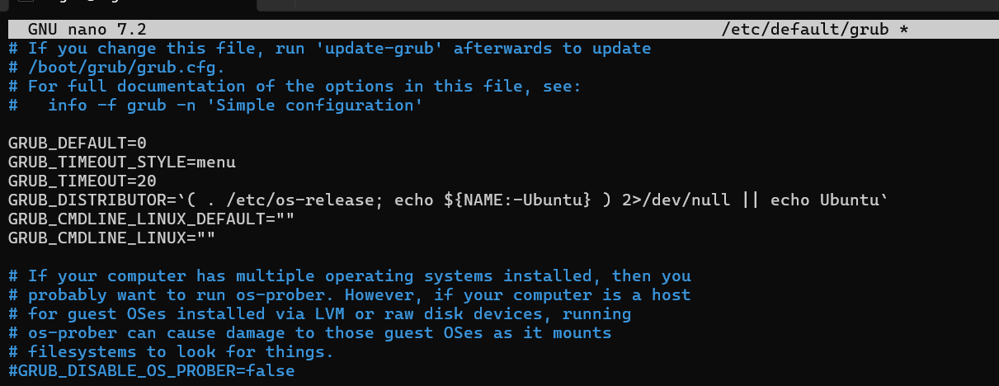
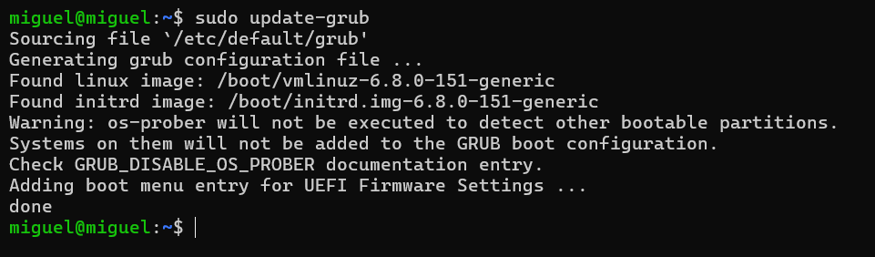
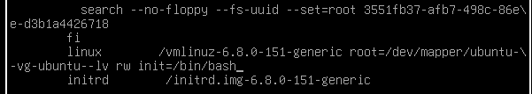
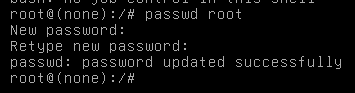
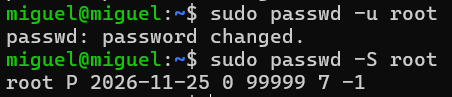
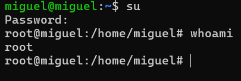

<h1 align="center">Práctica 4 – Configuración de GRUB y recuperación de contraseña root</h1>

  
  
  
  
  

  
  
  
  

---

## 📌 Descripción

Evidencias de la práctica realizada en Ubuntu Server (VMware) en el ITLA: se configuró el tiempo de espera del menú de **GRUB**, se usó el modo de edición de arranque para entrar en modo de recuperación (`rw init=/bin/bash`) y se restableció la contraseña del usuario **root**. Los comandos usados están en [GUIA.md](GUIA.md).

---

## 📸 Evidencias

### 1. Configuración de GRUB
En `/etc/default/grub` se cambió `GRUB_TIMEOUT_STYLE` a `menu` (para que el menú se muestre) y `GRUB_TIMEOUT` a `20` segundos, dando tiempo de interrumpir el arranque.

### 2. Aplicar los cambios con `update-grub`
`sudo update-grub` regenera la configuración de arranque y confirma que encontró la imagen de Linux, terminando con `done`.

### 3. Edición de la línea de arranque en GRUB
Desde el menú de GRUB, con `e` se edita la entrada y se agrega `rw init=/bin/bash` al final de la línea `linux`, para arrancar directo a una shell de root sin pedir contraseña.

### 4. Cambio de la contraseña de root
Ya dentro de la shell de recuperación, `passwd root` permite definir una nueva contraseña, confirmada con `password updated successfully`.

### 5. Cuenta root desbloqueada
Tras reiniciar, se usó `sudo passwd -u root` para desbloquear la cuenta y `sudo passwd -S root` confirma el estado `P` (contraseña activa).

### 6. Acceso como root con la nueva contraseña
Con `su` se inicia sesión como root usando la contraseña restablecida; `whoami` confirma que el usuario activo ahora es `root`.

---

## 👤 Autor

**Miguel Ramírez (Meli)** · Matrícula 20251367
Institución: ITLA
Materia: Sistemas Operativos 3
Profesor: Adrián Alcántara
