<h1 align="center">Práctica 3 – Configuración SSH entre dos máquinas Linux</h1>

  
  
  
  
  

  
  
  

---

## 📌 Descripción

Evidencias de la práctica realizada en dos máquinas virtuales Ubuntu Server (VMware) en el ITLA: configuración del servidor y cliente **SSH**, conexión remota con contraseña entre **Linux 1** y **Linux 2**, y autenticación por **clave pública** para entrar sin contraseña. Los comandos usados están en [GUIA.md](GUIA.md).

**Linux 1** (servidor): usuario `miguel`, equipo `miguel1`, IP `10.13.67.34`
**Linux 2** (cliente): usuario `miguel`, equipo `miguel2`, IP `10.13.67.35`

---

## 📸 Evidencias

### 1. IP de Linux 1
`ip a` en Linux 1 muestra la interfaz `ens33` con la IP `10.13.67.34`, necesaria para que Linux 2 se conecte a ella.

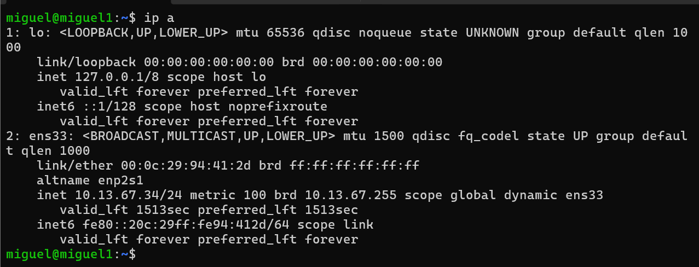

### 2. IP de Linux 2
`ip a` en Linux 2 muestra la interfaz `ens33` con la IP `10.13.67.35`, la máquina cliente desde donde se inicia la conexión.

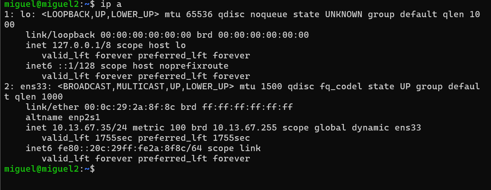

### 3. Servicio SSH activo en Linux 1
`sudo systemctl status ssh` confirma que el servicio está `active (running)` y `enabled`, listo para recibir conexiones.

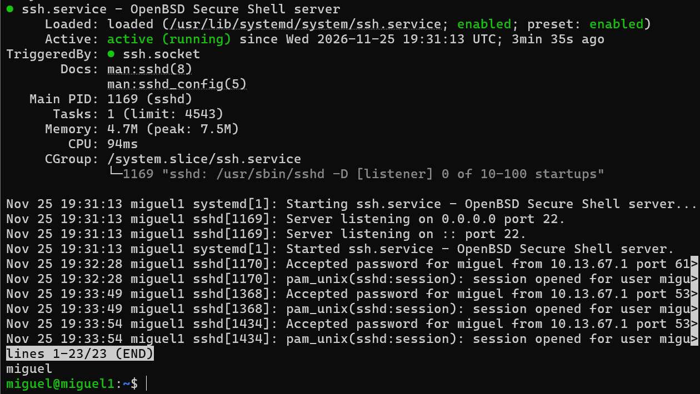

### 4. Servicio SSH activo en Linux 2
El mismo servicio también está activo en Linux 2, ya que ambas máquinas necesitan tener SSH instalado.

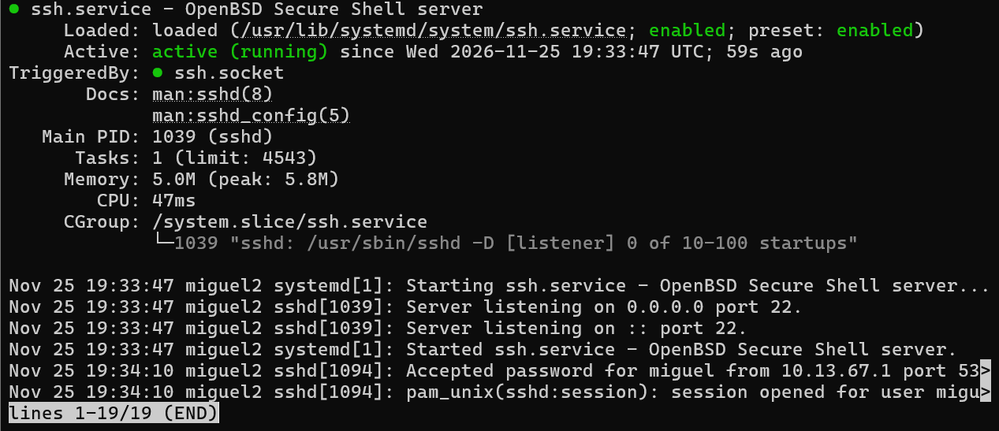

### 5. Generación del par de claves en Linux 2
`ssh-keygen` crea el par de claves ED25519 (privada y pública), mostrando el fingerprint y el randomart.

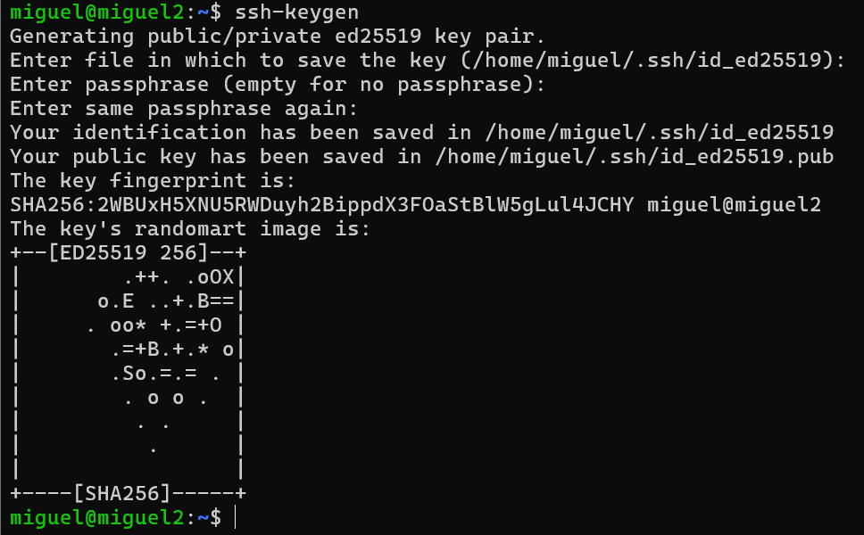

### 6. Clave pública generada
`cat ~/.ssh/id_ed25519.pub` muestra la clave pública completa de Linux 2, lista para copiarse a Linux 1.

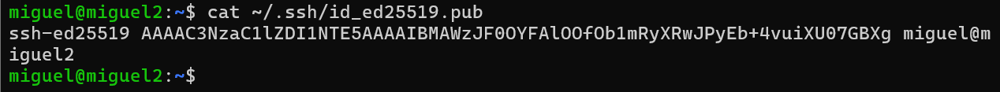

### 7. Primera conexión SSH con contraseña
Desde Linux 2 se conecta por primera vez a Linux 1 con `ssh miguel@10.13.67.34`. Se acepta el fingerprint del host y se introduce la contraseña.

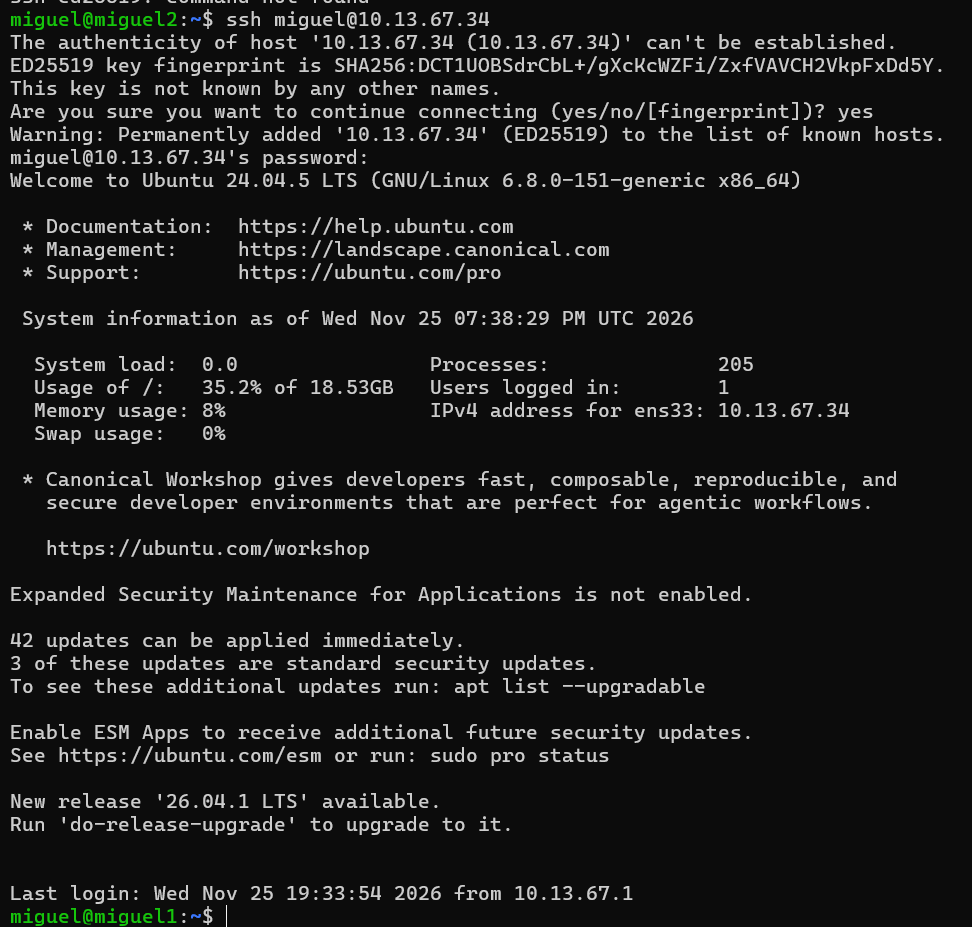

### 8. Verificación del usuario en Linux 1
Ya dentro de Linux 1, `whoami` confirma que la sesión pertenece al usuario `miguel`.

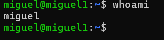

### 9. Clave pública agregada en Linux 1
Se crea `~/.ssh/authorized_keys` en Linux 1 y se pega la clave pública de Linux 2, confirmada con `cat`.

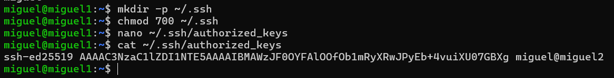

### 10. Permisos correctos de la carpeta y el archivo SSH
`chmod 600` sobre `authorized_keys` y `ls -la ~/.ssh` confirman los permisos obligatorios: `700` en la carpeta y `600` en el archivo.

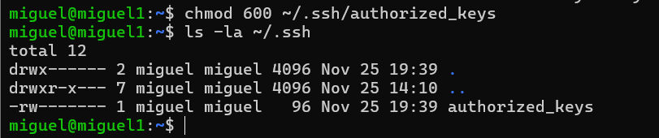

### 11. Conexión sin contraseña
Desde Linux 2, `ssh miguel@10.13.67.34` entra directo, sin pedir contraseña, lo que demuestra que la autenticación por clave pública funciona.

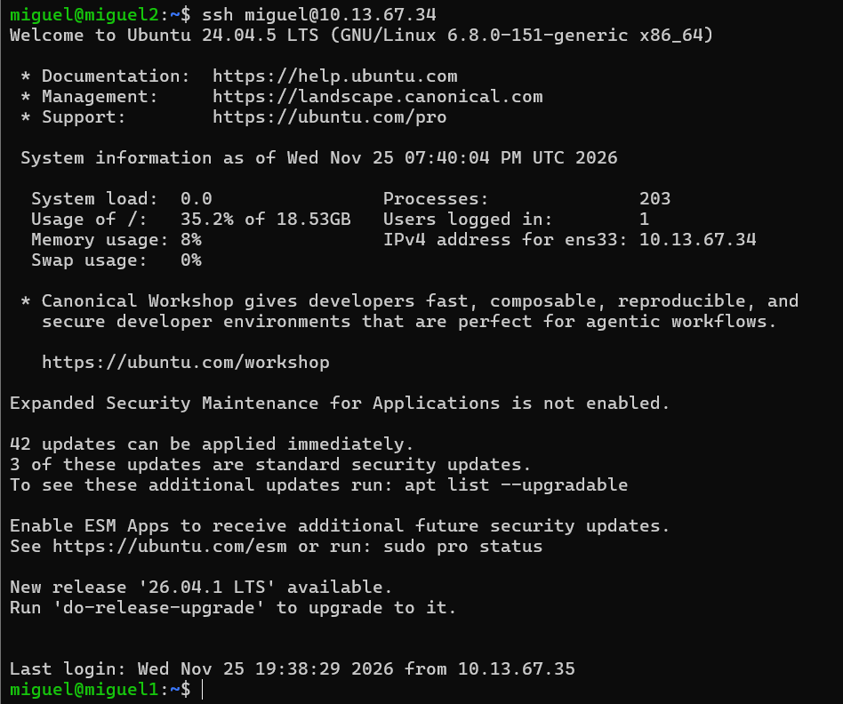

---

## 👤 Autor

**Miguel Ramírez (Meli)** · Matrícula 20251367
Institución: ITLA
Materia: Sistemas Operativos 3
Profesor: Adrián Alcántara
